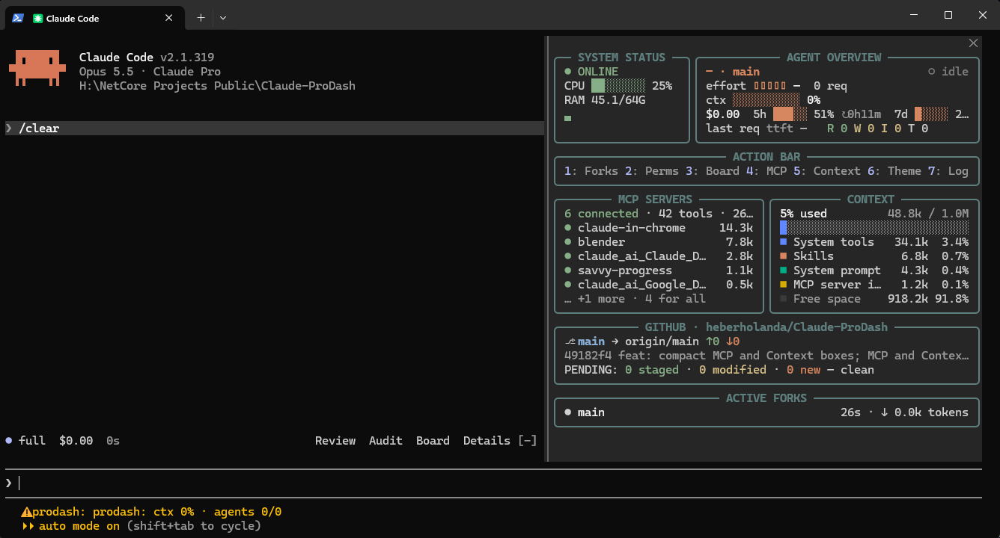

# Pro Dash

Pro Dash is a dashboard mod for [Claude Code](https://claude.com/claude-code). It keeps one pane beside the chat showing system load, the session's model and limits, MCP servers, the context window breakdown, the git repository and the live subagents (forks). It also has views for permission checks, project progress and color themes.



## Install

At the prompt of a Claude Code terminal session:

```
/plugin install prodash --marketplace heberholanda/Claude-ProDash
```

Answer `y` to add the marketplace, then pick a scope.

From a shell:

```
claude plugin install prodash --marketplace heberholanda/Claude-ProDash
```

In the desktop app: click **+** next to the prompt box, then **Plugins**, **Add marketplace** with `heberholanda/Claude-ProDash`, then **Add plugin**.

### Requirements

| Feature | Needs |
| --- | --- |
| CPU / RAM in System Status | Windows (PowerShell + CIM). Other systems show `n/a`. |
| GitHub section | `git` on the PATH and a git repository as the session folder |
| Pull request in GitHub section | [`gh`](https://cli.github.com/) installed and signed in |
| 5h / 7d rate limits | a Claude subscription (the API has no such windows) |

## Use

The pane opens by itself when the terminal is wide enough (144+ columns). Type `/prodash` to open it at any time.

When it is docked beside the transcript, the pane can take up to 45% of the terminal's width. A wide terminal shows everything.

### Main view

| Section | Shows |
| --- | --- |
| **System Status** | `ONLINE` / `DEGRADED` (CPU ≥ 90%) / `SYNCING`, CPU bar, RAM used/total, CPU history |
| **Agent Overview** | model · branch, busy/idle, effort level, permission mode, context window bar with tokens used/window and compactions, session cost and request count, 5h and weekly rate limits with % used and time to reset |
| **Action Bar** | `1` Forks · `2` Perms · `3` Board · `4` MCP · `5` Context · `6` Theme; the open view is the bright one |
| **MCP Servers** | connected servers, tool count and schema tokens; the 5 heaviest servers with their tokens (failed / pending ones first, with their status) |
| **Context** | % used, tokens used / window, a stacked bar, the 4 heaviest categories and the free space, with tokens and share |
| **GitHub** | `owner/repo`, branch → upstream, ahead/behind, stash, open PR, last commit, files pending commit (staged / modified / new) with their paths |
| **Active Forks** | `main` and one row per running subagent with its current activity (the task it has in progress, else its latest tool call), elapsed time and tokens; click a row to open that agent's transcript, `main` to come back |

### Action bar views

Press the key again, or **BACK**, to return to the main view.

**`1` Forks**: Active Forks at full height, for when the list does not fit the main view: `main` and every subagent with its current activity, tool calls, elapsed time and tokens. Pick one to open its transcript, `main` to come back.

**`2` Perms**: every permission check of the session.
- A color strip with one square per check: allowed, approved by the auto-mode classifier, approved by you, pending, denied.
- Totals by kind, by category (file · shell · other), reads vs writes, main vs forks.
- Average wait for an approval and the auto-approve rate.
- **Top rules**: the settings rules that decided most often.
- **Top tools**: calls run and denied per tool.
- **Recent asks & denials**: time, outcome, tool, command or file, wait, and the reason for a denial.

**`3` Board**:
- **Plan**: steps of the last approved plan (plan mode) with progress, marked done when a completed task matches the step; task counts and the task in progress.
- **Files touched**: each file edited this session with `+` / `−` lines, new files marked.
- **Timeline**: your requests with time, tool calls and duration.
- **Background**: shells and monitors running in the background.
- **Scheduled**: cron jobs and wakeups with their next run.

**`4` MCP**: every MCP server with its status, tools loaded / total, calls, errors, average latency, last use and schema tokens, and the error of a failed one; the summary splits the tokens in context now from the deferred ones.

**`5` Context**: the whole `/context` breakdown: model, autocompact threshold, every category (messages, system tools, skills, system prompt, MCP tools, memory files, autocompact buffer, free space, deferred tools) heaviest first with Free space last, the memory files with their tokens, and the skills heaviest first.

**`6` Theme**: the dashboard's colors.
- **Presets** (soft palettes): `default`, `matrix`, `dracula`, `nord`, `amber`, `cyberpunk`, `mono`, and `vivid` (bright colors).
- **Custom**: starts from the last preset and lets you set each role (border, ok, warn, bad, info, accent, dim, text) from a list of colors or by typing `#rrggbb` + Enter. Changed roles show `*`; **RESET CUSTOM** undoes them.
- The theme is saved across sessions.

To type in the custom fields, open the pane with `/prodash` so it holds the keyboard.

## How it gets its data

The mod only uses the Claude Code plugin API: it reads tool calls, permission checks, model requests, turns and the session's usage as they happen. It sends nothing anywhere.

| Data | Source |
| --- | --- |
| Agents and forks | `$.agent.list()`, polled every 250 ms while a fork runs, every 1 s otherwise |
| Context, cost, rate limits | `$.session.usage()` every 1 s, written only when a figure changes |
| Context breakdown, MCP schema tokens | `$.session.usage({ breakdown: 'summary' })` (local estimate, no API call) after each turn and every 30 s |
| Model, effort, requests | each model request (`turn.step`) |
| Permission checks | `tool.check`; an ask's outcome when its call returns |
| MCP servers | the session's tool list every 30 s, `WaitForMcpServers` / `ToolSearch` results, MCP tool calls |
| Files, plan, tasks, background, schedules | the results of Edit / Write, ExitPlanMode, TaskCreate / TaskUpdate / TodoWrite, background Bash / Monitor, CronCreate / CronList |
| CPU / RAM | one PowerShell CIM query every 15 s |
| Git | `git status` every 10 s (60 s outside a repo), `git log` when HEAD moves, remote and `gh pr view` every 60 s |

### Limitations

- Counters start when the mod loads. Earlier permission checks and tool calls are not shown; earlier requests appear in the timeline without a time.
- A subagent leaves Active Forks once it ends.
- A fork's activity is built from its tool calls and tasks; the short summary Claude Code's own subagent panel shows is not in the plugin API.
- There is no API event for "the person refused this ask": a call that waited on an ask and ends with an error worded as a refusal is counted as denied.
- The classifier is only told apart from your own approvals while the session shows auto mode.
- Background shells and schedules are rebuilt from tool calls and refreshed each time Claude stops; there is no live list.

## Performance

Nothing the mod does holds a tool call or a model request. Per-call data (logs, tool counts, permission checks, MCP stats, fork counters) stays in memory; only what changed is written, in one batch per second and at the end of each turn. Timers never overlap and they back off when idle. Every list kept in memory has a cap: 500 log lines, 300 permission checks, 200 files, 50 requests.

## Develop

The mod is a Claude Code plugin of function hooks:

```
.claude-plugin/plugin.json        manifest
.claude-plugin/marketplace.json   makes this repo installable
hooks/hooks.json                  names the hooks module
hooks/register.tsx                the whole mod
types/index.d.ts                  the state it keeps (its contract)
tests/prodash.test.tsx            tests (rendering, counters, layout)
```

```
claude plugin validate .
claude plugin test .
```

To run it from a working copy: `claude --plugin-dir <this folder>`.

## License

MIT
